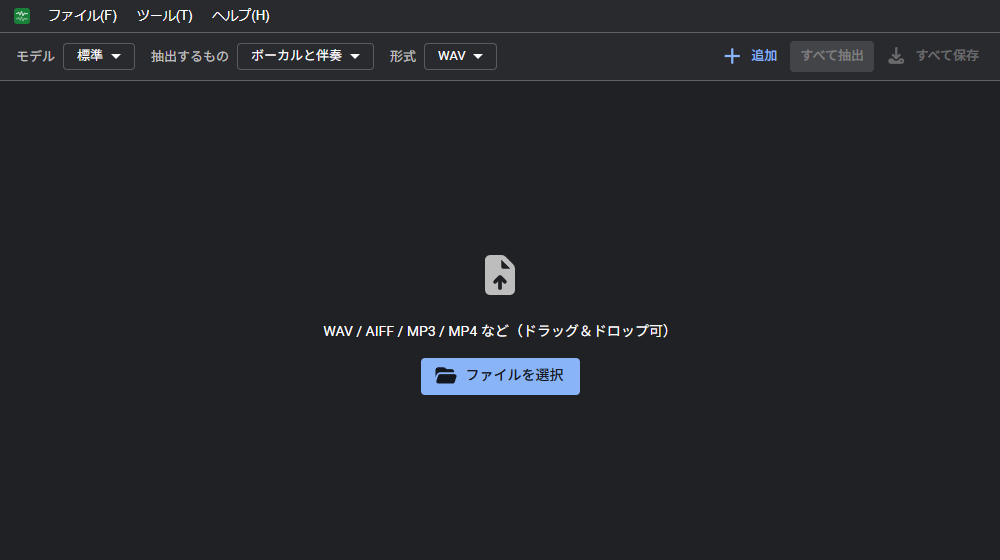

# 基本の流れ
曲を追加してから保存するまでの流れと、対応ファイル、データの保存先。

1. **追加する**: 曲のファイルを画面にドラッグ＆ドロップするか、「ファイルを選択」「追加」（Ctrl+O）で選択する。複数のファイルを一括で追加できる
2. **設定する**: モデル、抽出するもの、形式を選択する
3. **抽出する**: 「すべて抽出」をクリックする。上から 1 曲ずつ抽出する。1 曲のみ抽出する場合は、その行の「抽出」をクリックする
4. **試聴する**: 完了した曲の ▶ で結果を再生する
5. **保存する**: 行の「ボーカル」「伴奏」で個別に、「すべて保存」で一括で保存する

## 対応ファイル

| 種類 | 例 |
| --- | --- |
| 音声ファイル | WAV、AIFF、MP3、M4A（AAC）、FLAC、Ogg など（ブラウザによって読み込めない形式がある） |
| 動画ファイル | MP4（音声のみを使用する） |

## オフラインとデータの保存

- 曲は端末の外部に送信されない。抽出はすべてブラウザ内で行う
- モデルは初回の抽出時にダウンロードし、ブラウザに保存する。2 回目以降はダウンロードしない
- 一度開いたあとは、オフラインでも利用できる（使用するモデルを保存済みの場合）
- ブラウザの「インストール」（ホーム画面に追加）で、アプリとして起動できる
- 閉じたあとも、一覧と結果を保持できる（[設定](settings.md) の「データ」）
