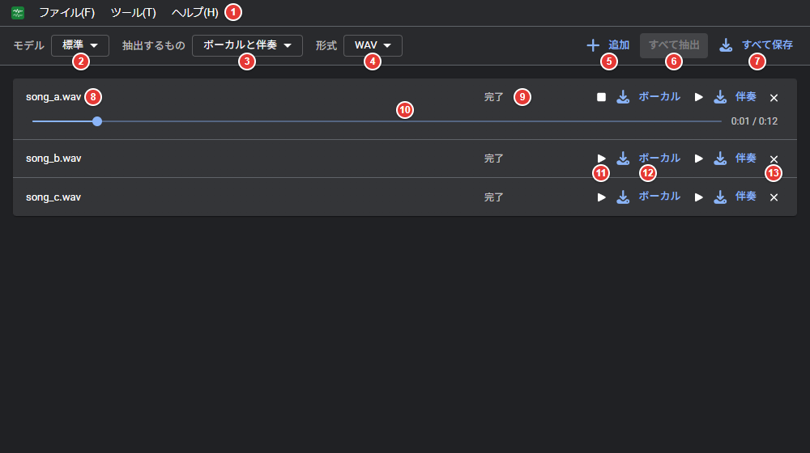
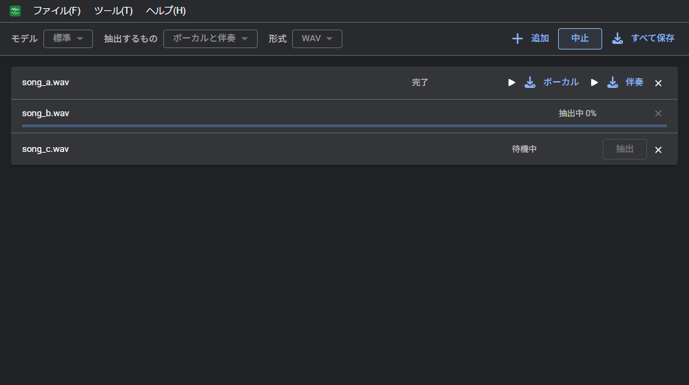
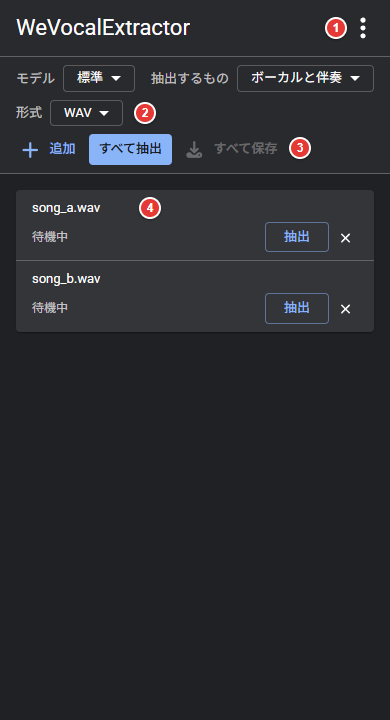

# 画面
パソコンとスマホの画面の各部の名前と役割。

## パソコン

| 番号 | 場所 | 内容 |
| --- | --- | --- |
| 1 | メニューバー | ファイル、ツール、ヘルプ |
| 2 | モデル | 軽量/標準/高精度から選択する（[抽出の設定](extract.md#抽出の設定)） |
| 3 | 抽出するもの | ボーカルと伴奏/ボーカルのみ/伴奏のみ |
| 4 | 形式 | 保存する形式（WAV / MP3 / Opus） |
| 5 | 追加 | 曲のファイルを一覧に追加する |
| 6 | すべて抽出 / 中止 | 待機中の曲を順に抽出する。抽出中は「中止」に切り替わる |
| 7 | すべて保存 | 抽出した結果を ZIP にまとめて保存する |
| 8 | ファイル名 | 追加した曲の名前 |
| 9 | 状態 | 待機中/抽出中（進捗）/完了/失敗 |
| 10 | 再生位置 | 試聴中の曲に表示される。ドラッグで位置を移動する |
| 11 | 試聴 | 結果を再生する。再度クリックすると停止する |
| 12 | 保存 | 「ボーカル」「伴奏」をクリックすると、その結果を保存する |
| 13 | 削除 | 曲を一覧から削除する |

メニューバーはキーボードでも操作できる。Alt（単独で押して離す）か F10 でメニューバーに移動し、「ファイル(F)」の F などでそのメニューを開く。

| メニュー | 項目 |
| --- | --- |
| ファイル(F) | 追加（Ctrl+O）、すべて保存、設定 |
| ツール(T) | すべて抽出、一覧を空にする |
| ヘルプ(H) | ユーザーガイド、ショートカット一覧、更新を確認、ライセンス情報、このアプリについて |

### 抽出中の画面

## スマホ

| 番号 | 場所 | 内容 |
| --- | --- | --- |
| 1 | メニュー（⋮） | 追加、すべて保存、設定など |
| 2 | 抽出の設定 | モデル、抽出するもの、形式 |
| 3 | 一覧の操作 | 追加、すべて抽出、すべて保存 |
| 4 | 一覧 | 曲ごとの状態と操作。パソコンの 1 行を 2 行に折り返して表示する |
