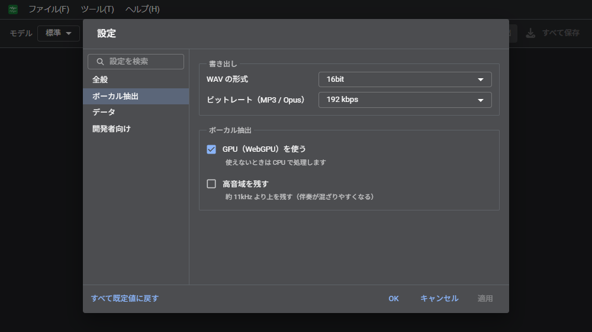

# 設定
設定画面の項目。

「ファイル」→「設定…」（スマホは「⋮」→「ヘルプ」→「設定…」）。

| 分類 | 項目 |
| --- | --- |
| 全般 | テーマ（システムに合わせる、ライト、ダーク）、言語、アップデートの確認 |
| ボーカル抽出 | WAV の形式（16bit / 24bit / 32bit float）、ビットレート（MP3 / Opus。128〜320 kbps）、GPU（WebGPU）を使う、高音域を残す |
| データ | 閉じたあとも一覧を残す、ダウンロードしたモデルの削除、残した一覧の削除 |
| 開発者向け | ダイアログの表示 |

| 項目 | 内容 |
| --- | --- |
| GPU（WebGPU）を使う | 対応しているブラウザでは処理が速くなる。利用できない場合は CPU で処理する |
| 高音域を残す | 約 11kHz 以上を残す。声は明るくなるが、伴奏が混入しやすい |
| 閉じたあとも一覧を残す | 未ダウンロードの結果のみ（既定）、ダウンロードした結果も、残さない |

設定画面の操作（検索、OK/キャンセル/適用、すべて既定値に戻す）は WeVocalSynth と共通である。
