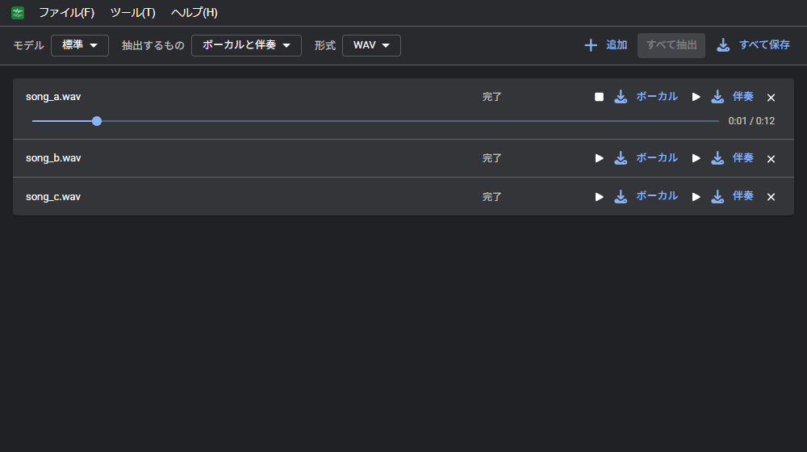

# WeVocalExtractor
WeVocalExtractor は、Web ブラウザで曲からボーカルと伴奏を取り出す音源分離ツールである。 
インストールは不要。音声ファイルはサーバーへ送らず、推論はすべてブラウザ内で行う。

- アプリ: https://wevocalextractor.pitan76.net/
- ソースコード: https://github.com/PTOM76/wevocalextractor

## はじめに
1. [アプリ](https://wevocalextractor.pitan76.net/)を開き、曲のファイルを画面にドラッグ＆ドロップする（または「ファイル」→「追加」）
2. モデル、抽出するもの、形式を選び、「すべて抽出」を押す
3. 完了した曲の「ボーカル」「伴奏」、または「すべて保存」で保存する

詳しくは [基本の流れ](basics.md) を参照。言葉の意味は [用語](glossary.md) にまとめている。

## できること
| 分類 | 機能 |
| --- | --- |
| 抽出 | 複数の曲をまとめて追加し、1 曲ずつ順に取り出す（ボーカルと伴奏 / ボーカルだけ / 伴奏だけ）。曲ごとの進み具合と中止、やり直し |
| モデル | 軽量 / 標準 / 高精度の 3 種類から選択、初回に取得したモデルを保存して 2 回目から再利用 |
| 実行方法 | GPU（WebGPU）と CPU（WASM）。GPU が使用できなければ CPU で処理する |
| 保存 | 曲ごとの試聴と保存（WAV / MP3 / Opus）、すべてを ZIP でまとめて保存 |
| その他 | パソコンとスマホに対応、オフラインで使用できる、ライト / ダーク、日本語、英語 |

## 使い方
| ページ | 内容 |
| --- | --- |
| [画面](screen.md) | パソコンとスマホの画面の各部の名前と役割 |
| [基本の流れ](basics.md) | 追加してから保存するまでの流れ、対応ファイル、データの保存先 |
| [抽出](extract.md) | 抽出の設定と、一覧の操作 |
| [保存](save.md) | 抽出した結果の保存 |
| [設定](settings.md) | 設定画面の項目 |
| [キーボード操作](shortcuts.md) | キーボードで使用できる操作の一覧 |
| [困ったとき](troubleshooting.md) | うまく動かないときの対処 |

## その他
- [用語](glossary.md)
